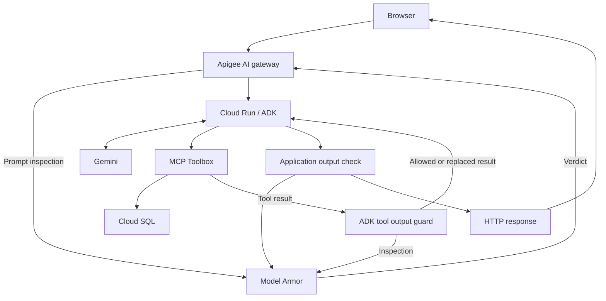

# Guardrails for AI Agents

A supply-chain assistant demonstrating prompt-injection controls at the gateway and inside the agent. Prepared for DevFest Mexico, Cairo and Ahlen: one English slide deck, recorded demonstrations, no live coding.

Built on [Google’s secure-agent Model Armor codelab](https://codelabs.developers.google.com/secure-agent-modelarmor). This implementation adapts the database to **Cloud SQL** and adds an incoming **Apigee AI gateway** plus a browser interface. Inspect the original codelab and its license when reusing upstream material.

## What actually runs

The deployed application starts at **`agent/app.py`**, via `agent/Dockerfile`. It uses Flask, an ADK orchestrator, inventory and logistics specialists, Gemini, and MCP Toolbox for Databases.



**Scope:** Apigee protects incoming `/secure-agent/chat` requests. The current application does **not** route every internal model or tool call through Apigee. The callback checks tool results after execution and cannot undo side effects.

## Three demonstration scenarios

| Scenario | Input | Previously observed result |
|---|---|---|
| Business question | Ask for laptop inventory | HTTP 200 and a business answer |
| Direct injection | Ask to override instructions and reveal the system prompt | HTTP 403 with gateway `PROMPT_BLOCKED` |
| Indirect injection | Retrieve the synthetic supplier note | Tool result withheld by the callback; final HTTP response can still be 200 |

These are specific observed tests, not a guarantee against all prompt injection. The supplier note is an intentionally hostile fixture, enabled only with `ENABLE_DEMO_FIXTURE=true`. It does not come from a real supplier record. A dedicated sensitive-output test and scanner-outage test still need validation.

## Repository map

| Path | Status and purpose |
|---|---|
| `agent/app.py` | Current Flask / ADK application |
| `agent/templates/index.html` | Frontend actually rendered by Flask |
| `agent/templates/secure-agent-ui.html` | Earlier alternate UI file; not the active template |
| `agent/tools.yaml` | Toolbox configuration, with password injected at Toolbox startup |
| `agent/.env.example` | Current application environment example |
| `agent/agent.py`, `config.py`, `tools.py`, `model_armor_client.py` | Earlier tool-proxy design, not imported by the current application |
| `apigee/apiproxy/`, `apigee/sharedflows/` | Earlier `/agent-tools` proxy scaffold, not an export of the deployed `/secure-agent` proxy |
| `terraform/` | Partial earlier infrastructure scaffold, not a reproduction of the deployed PSC/load-balancer setup |
| `docs/` | Current architecture, setup, evidence and security notes |
| `scripts/demo-tests.sh` | Manual API scenarios against your configured gateway |

Do not deploy the earlier scaffold expecting it to reproduce the current running demo. The actual Apigee proxy revision must be exported and reviewed first. See [Apigee configuration](docs/apigee.md).

## Run the application locally

Requires Python 3.11, Google Application Default Credentials, access to a configured Model Armor template, a reachable Toolbox service and model credentials. Toolbox and the SQL schema/data must already exist.

```bash
cd agent
python3 -m venv .venv
source .venv/bin/activate
pip install -r requirements.txt
cp .env.example .env
# Edit .env locally. Never commit its secret values.
gcloud auth application-default login
python app.py
```

The app listens on port 8080 by default. `POST /chat` is the Flask endpoint. Through Apigee, its path is `/secure-agent/chat`.

The browser UI is designed for the deployed Apigee origin. Outside that origin it defaults to a clearly labelled sample preview, with illustrative responses. This preview performs no security test. Do not disable CORS to make cross-origin live calls work. Use the gateway-hosted UI or deliberately configure and test an allowed origin. The current frontend contains the original demo hostname; adapt it before using another environment.

## Configure Toolbox separately

`agent/tools.yaml` belongs to the **Toolbox server**. The Flask process only uses `TOOLBOX_SERVER` to connect to it. Set `DB_PASSWORD` on the Toolbox process, preferably from Secret Manager in Cloud Run. Loading `.env` in Flask does not configure a separate Toolbox service. The existing YAML schema must match your Toolbox server version.

See [Setup and deployment](docs/setup.md) for configuration and deployment boundaries. The repository does not provision a database schema or load sample data automatically.

## Run the manual scenarios

```bash
export GATEWAY_URL='https://YOUR_GATEWAY_HOST/secure-agent'
bash scripts/demo-tests.sh
```

Each run uses distinct sessions. Confirm blocks with gateway Debug or callback logs, not HTTP status alone. A successful final response does not mean that every tool result was allowed. Do not run the fixture scenario in an environment where it is disabled and expect a tool-block result.

## Evidence and limitations

The frontend displays only final response data and optional structured security events. The current backend does not emit those events, so internal stages may say **Not observed**. This is not a live end-to-end trace. Client-generated request IDs are not server correlation IDs unless the server implements that contract.

- The application inspects input and output and serializes tool results for inspection.
- On an inspection exception it withholds content. The current matching logic does not prove every individual filter completed successfully.
- The tool guard returns a replacement error to the model; it does not itself guarantee an HTTP 403 for the full request.
- Session and memory services are in-memory and do not survive restarts or coordinate across instances.
- The current app uses the Flask development server. It is a demonstration, not a production deployment blueprint.
- Gateway-to-backend identity protects access only when Cloud Run actually enforces it. Verify current IAM and invoker-check settings. Do not infer backend privacy from older tests.
- API keys, rate limiting, token budgets, semantic caching and model failover are not demonstrated by the current incoming proxy configuration.

See [Architecture](docs/architecture.md), [demo evidence](docs/demo.md), and [security notes](SECURITY.md).

## References

- [Secure-agent Model Armor codelab](https://codelabs.developers.google.com/secure-agent-modelarmor)
- [ADK documentation](https://google.github.io/adk-docs/)
- [Model Armor with Apigee](https://cloud.google.com/model-armor/model-armor-apigee-integration)
- [MCP Toolbox](https://googleapis.github.io/genai-toolbox/)
