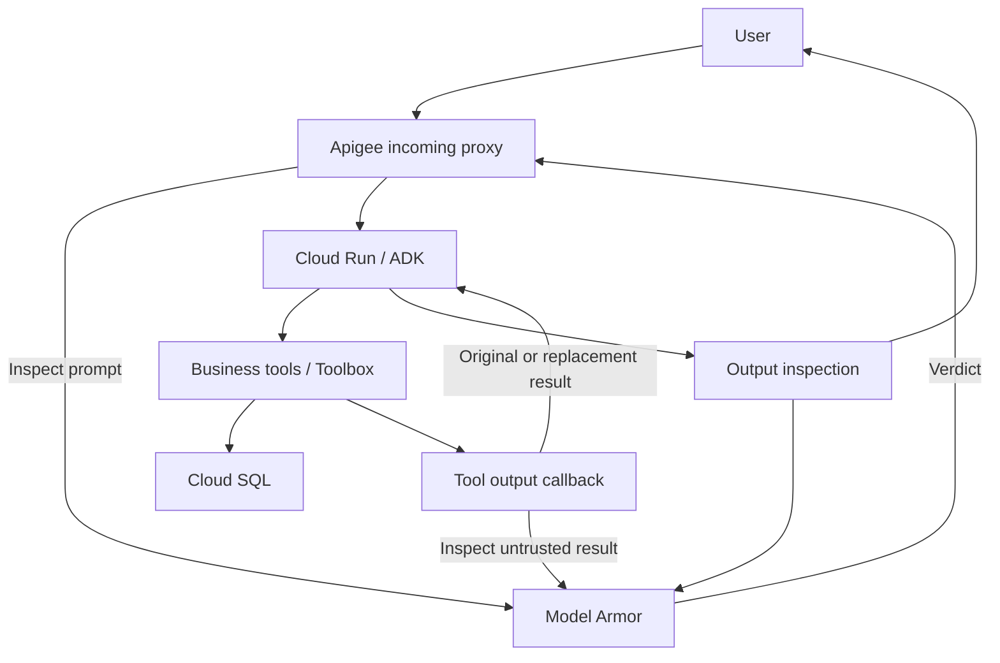

# Current demo architecture

The application entrypoint is `agent/app.py`. The earlier `agent/agent.py` tool-proxy example is not its runtime entrypoint.

## Four trust boundaries

| Boundary | Control | Evidence / limitation |
|---|---|---|
| User to gateway | Validate POST /chat and call Model Armor | Inspect the actual gateway verdict and Debug trace |
| Gateway to application | Apigee service identity and Cloud Run invoker authorization | Only enforced when backend anonymous invocation is disabled; revalidate current access |
| Tool result to model | ADK after_tool_callback invokes content inspection and may replace the result | Runs after execution; cannot undo a write |
| Generated answer to user | Application calls Model Armor on output | Dedicated leakage test still needs validation; blocking is different from redaction |

Gemini participates in the ADK execution loop. Toolbox and Cloud SQL are separate services, not components inside the agent container. The synthetic supplier-note tool is local to the application and intentionally bypasses the database to make the indirect-injection test reproducible.

## Earlier scaffold

`apigee/apiproxy` describes a different topology: agent tools routed through `/agent-tools`. It includes API-key and SpikeArrest policies. Those files do not establish that these controls are deployed in the current incoming gateway. `terraform/` is partial and must not be applied blindly to an existing project.
