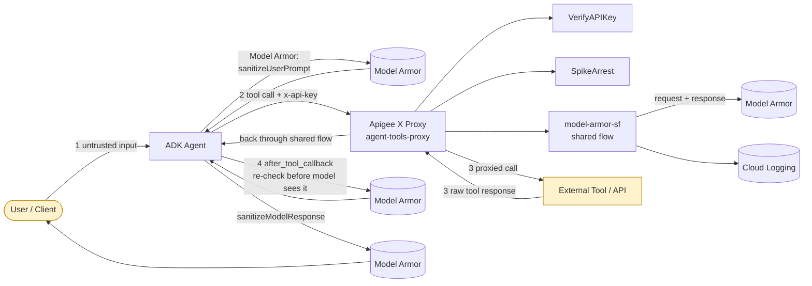

# Architecture

Placeholder for a rendered architecture diagram. The source lives at
[diagrams/architecture.mmd](diagrams/architecture.mmd) (Mermaid); GitHub
renders it inline below. Swap this for an exported PNG/SVG under
`diagrams/` if you'd rather ship a static image — update the link here
when you do.

See the README's [Architecture](../README.md#architecture) and
[Threat model](../README.md#threat-model-four-trust-boundaries) sections
for what each numbered boundary enforces.
